# University Examination Timetable Scheduling System

[](https://www.python.org/)
[](https://fastapi.tiangolo.com/)
[](https://react.dev/)
[](https://www.typescriptlang.org/)
[](https://tailwindcss.com/)
[](https://opensource.org/licenses/MIT)
[](https://www.w3.org/WAI/standards-guidelines/wcag/)

An enterprise-grade, constraint-based university examination scheduling platform powered by Graph Coloring algorithms (**DSATUR**, **Welsh–Powell**, and **Greedy Coloring**). It eliminates exam double-bookings across faculties, optimizes student rest intervals, and automates institutional examination publishing.

---

## Table of Contents

1. [Executive Summary & The Timetabling Problem](#1-executive-summary--the-timetabling-problem)
2. [System Architecture](#2-system-architecture)
3. [Comprehensive Feature Catalog](#3-comprehensive-feature-catalog)
   - [A. Public Academic Registry & Landing Page](#a-public-academic-registry--landing-page)
   - [B. Non-Technical User Quick Guide](#b-non-technical-user-quick-guide)
   - [C. Operations Command Center & Overview](#c-operations-command-center--overview)
   - [D. Academic Data Management & Bulk CSV Import](#d-academic-data-management--bulk-csv-import)
   - [E. Interactive Conflict Graph Visualizer](#e-interactive-conflict-graph-visualizer-gve)
   - [F. Automated Schedule Generation Engine](#f-automated-schedule-generation-engine)
   - [G. Algorithm Comparison Lab](#g-algorithm-comparison-lab)
   - [H. Master Timetable Grid & Conflict-Aware Drag/Move](#h-master-timetable-grid--conflict-aware-dragmove)
   - [I. Exam Locking & Partial Regeneration](#i-exam-locking--partial-regeneration)
   - [J. Official Publishing Pipeline & Multi-Format Exports](#j-official-publishing-pipeline--multi-format-exports)
   - [K. Student Examination Portal & Hall Ticket Lookup](#k-student-examination-portal--hall-ticket-lookup)
   - [L. Institutional Governance, Soft Constraints & Audit Trail](#l-institutional-governance-soft-constraints--audit-trail)
   - [M. Security, RBAC & FERPA Compliance](#m-security-rbac--ferpa-compliance)
4. [Graph Coloring Algorithms & Mathematical Model](#4-graph-coloring-algorithms--mathematical-model)
5. [Core Technology Stack](#5-core-technology-stack)
6. [Quickstart Guide](#6-quickstart-guide)
7. [Demonstration Accounts & Seed Dataset](#7-demonstration-accounts--seed-dataset)
8. [Automated Testing & Quality Assurance](#8-automated-testing--quality-assurance)
9. [Deployment Guide](#9-deployment-guide)

---

## 1. Executive Summary & The Timetabling Problem

Creating a conflict-free university examination schedule for thousands of students across dozens of degree programs is an NP-hard combinatorial optimization problem. When courses share enrolled students, scheduling those exams at the same time causes **hard double-booking clashes**. Furthermore, forcing students to sit multiple exams in a single day or consecutive back-to-back sessions causes academic fatigue.

**ExamScheduler solves this mathematically:**
- **Zero Double-Bookings (Hard Constraint Guarantee):** Courses with shared students are modeled as connected vertices in an undirected **Conflict Graph** $G = (V, E)$. Graph coloring algorithms partition the graph into independent chromatic classes where no two adjacent vertices share a color.
- **Fair Spacing & Session Balance (Soft Constraint Optimization):** Colors are assigned to physical calendar time slots via a bipartite penalty minimizer that penalizes consecutive sessions, multiple exams on the same calendar day, and morning/afternoon distribution imbalances.
- **End-to-End Workflow:** From bulk CSV spreadsheet imports to interactive canvas graph exploration, calendar drag-and-drop adjustments, one-click PDF/Excel generation, and student hall ticket lookup.

---

## 2. System Architecture

```mermaid
flowchart TD
    subgraph Client ["Frontend (React 18 + TypeScript + Vite + Tailwind CSS)"]
        Landing["Public Collegiate Landing Page & Student Lookup"]
        Guide["Non-Technical Plain-English Quick Guide Box"]
        Console["Staff Operations Dashboard & Active Cycle Switcher"]
        GraphUI["Interactive ReactFlow Conflict Graph G=(V,E)"]
        GeneratorUI["Automated Schedule Generator & Algorithm Lab"]
        TimetableUI["Interactive Calendar Grid & Clash-Aware Move Modal"]
        StudentPortal["FERPA Student Portal & Printable Hall Ticket"]
        ImportWizard["3-Step Bulk CSV Import Wizard"]
        SettingsUI["RBAC Users, Audit Trail & Constraint Weights"]
    end

    subgraph Gateway ["HTTP Gateway & Security Middleware"]
        AuthMiddleware["Argon2id Auth & HTTP-Only Secure Cookies"]
        RBAC["Role-Based Access Control (Admin, Coord, Faculty, Student)"]
        CSRF["Anti-CSRF & Rate-Limiting Protection"]
        SecurityHeaders["CSP, HSTS, X-Content-Type-Options"]
        ErrorEnvelope["Standardized RFC 7807 Error Envelope Handler"]
    end

    subgraph CoreEngine ["Backend Application Core (FastAPI + SQLAlchemy 2.0)"]
        GraphService["Conflict Graph Construction Engine O(m*k^2)"]
        AlgorithmEngine["Graph Coloring Engine: DSATUR / Welsh–Powell / Greedy"]
        SlotMapper["Bipartite Slot Mapping & Soft Penalty Minimizer"]
        ValidatorEngine["Independent Constraint Verification Engine"]
        PublishService["Immutable Publishing Pipeline & Exporter"]
        AuditService["Tamper-Evident Institutional Audit Trail"]
    end

    subgraph Storage ["Persistent Storage"]
        DB[("PostgreSQL 16 / SQLite Relational Store")]
        Exports[("ReportLab PDF & OpenPyXL Excel Generators")]
    end

    Client -->|REST JSON + Secure Cookies| Gateway
    Gateway --> CoreEngine
    CoreEngine --> Storage
```



---

## 3. Comprehensive Feature Catalog

### A. Public Academic Registry & Landing Page
- **Collegiate Aesthetic:** Crafted in warm alabaster paper tones (`#f8f7f4`), Oxford deep ink typography, and `Marcellus` serif display headings.
- **Live Schedule Register:** An interactive widget allowing prospective students and visitors to filter official exam sessions by Faculty (*Computing, Mathematics, Engineering, Economics*) and Time (*Morning 09:00 / Afternoon 14:00*).
- **Public Schedule Ledger:** Complete tabular view of all published exams showing course code, title, faculty, date, session slot, assigned examination hall, student count, and conflict verification status.
- **Candidate Seat & Schedule Lookup:** Instant public lookup where students enter their registration roll number (e.g. `STU-2024-001`) to view individual scheduled dates, assigned examination halls, and reserved row/seat numbers without requiring a password.

### B. Non-Technical User Quick Guide
- **Zero-Jargon Explanations:** Explains the core purpose of the project in clear, non-technical terms — eliminating exam overlap headaches without complex mathematics.
- **Interactive Role Tabs:**
  - **3-Step Overview:** Explains the entire pipeline in 3 simple steps (*1. Input Courses & Students &rarr; 2. Click 'Generate' &rarr; 3. Review & Look Up Dates*).
  - **For Students:** Step-by-step guidance on how to find personal exam dates, times, and hall seats, complete with one-click sample student buttons (`STU-2024-001`, `STU-2024-042`, `STU-2024-108`).
  - **For Coordinators & Staff:** A clear 5-step operational walkthrough covering cycle selection, spreadsheet import, one-click schedule generation, grid adjustments, and official publication.
- **Collapsible Control:** Built-in expand/collapse toggle allowing experienced users to minimize the guide to a single summary bar or expand it anytime.

### C. Operations Command Center & Overview
- **Executive Metric Cards (KPIs):** Real-time monitoring of Total Exams, Registered Students, Total Course Enrollments, Graph Vertices & Edges, Average Conflict Degree (conflict density), Time Slots Used, and Latest Published Version details.
- **Active Cycle Switcher:** Persistent selector to effortlessly switch context between different academic semesters or examination periods.
- **Stale Data Intelligence:** Automatic background detector that monitors whether subjects or student enrollments have changed since the conflict graph was last compiled, presenting a one-click **Rebuild Graph** trigger.
- **Quick-Action Launchers:** Direct shortcut buttons to launch the Bulk Import Wizard, open the Graph Visualizer, or initiate Timetable Generation.

### D. Academic Data Management & Bulk CSV Import
- **Course & Subject Catalog (`/subjects`):** Add, update, and manage academic subjects with course codes, department mappings, credit hours, durations, and preferred date windows.
- **Student & Enrollment Registry (`/students`):** Comprehensive directory of registered candidates, search and filter by department or roll number, and manage individual student course enrollments.
- **3-Step Transactional CSV Import Wizard:**
  1. *Template Download & Selection:* Download pre-formatted, validated CSV template files for Subjects, Students, or Course Enrollments.
  2. *Drag-and-Drop Upload:* Upload spreadsheet files with immediate MIME-type and header inspection.
  3. *Dry-Run Validation & Batch Commit:* Previews incoming rows, highlights syntax or referential errors line-by-line, and commits valid records within an isolated database transaction.

### E. Interactive Conflict Graph Visualizer $G=(V, E)$
- **Interactive Topology Canvas (`/graph`):** Powered by ReactFlow with smooth zooming, panning, circular and force-directed layouts, and interactive node positioning.
- **Conflict Modeling:** Vertices represent exam courses; edges represent shared student enrollments with line thickness proportional to the count of mutually registered students.
- **Dynamic Filtering:**
  - Live search input to highlight courses by code (e.g. `CS101`) or course title.
  - Interactive **Min Degree Slider** to filter out low-conflict courses and isolate high-density exam clusters.
- **Node Inspector Drawer:** Clicking any course node opens a detailed sliding pane displaying its exact degree, course title, department, and conflict connections while preserving student anonymity.
- **Graph Topology Export:** Export the complete conflict topology as CSV or JSON for external audit and academic analysis.
- **Informative Empty States:** Intelligent empty-state guards that detect unseeded databases or unbuilt graphs and offer one-click **Rebuild** or **Load Demo Data** actions.

### F. Automated Schedule Generation Engine
- **Multi-Algorithm Coloring Suite (`/generate`):**
  - **DSATUR (Brélaz, 1979):** Dynamic saturation degree algorithm that dynamically prioritizes courses with the highest number of distinct colored neighbors. Recommended for minimal chromatic slots.
  - **Welsh–Powell (1967):** Static degree-ordered greedy heuristic that sorts courses by total conflict degree before slotting.
  - **Greedy Coloring:** Ultra-fast first-fit baseline algorithm.
- **Generation Parameters:**
  - *Preserve Locked Exams:* Respects pre-assigned or manually fixed exams during re-generation.
  - *Optimize Soft Constraints:* Runs bipartite penalty minimization to balance morning vs afternoon sessions and maximize rest days.
  - *Deterministic Execution:* Enforces consistent tie-breaking for 100% reproducible timetables.
- **Instant Generation Benchmarks:** Algorithmic calculation completes in $<100\text{ ms}$ for typical university cycles ($\le 500$ exams).
- **Validation Report:** Detailed post-generation report verifying 0 hard clashes and presenting a breakdown of soft penalty metrics.
- **Candidate Versioning:** Save generated results as candidate timetable versions for review and institutional approval.

### G. Algorithm Comparison Lab
- **Side-by-Side Benchmark Arena (`/lab`):** Executes DSATUR, Welsh–Powell, and Greedy coloring simultaneously against the active cycle's conflict graph.
- **Performance Comparison Metrics:**
  - Total execution runtime in milliseconds ($\text{ms}$).
  - Chromatic number ($\chi(G)$) / total session slots required.
  - Soft penalty score breakdown (consecutive session clashes, same-day multiple exams, session balance).
  - Mathematical verifiability indicators.
- **One-Click Promotion:** Directly save and promote the winning algorithm's output as the active schedule candidate.

### H. Master Timetable Grid & Conflict-Aware Drag/Move
- **Master Calendar Matrix (`/timetable`):** Matrix view organizing scheduled exams across calendar dates and session slots (Morning `09:00 - 12:00` / Afternoon `14:00 - 17:00`).
- **Department & Keyword Filtering:** Instantly filter timetable rows by department or search for specific subjects.
- **Interactive Move Modal:**
  - Select any scheduled exam to move it to a different calendar day or session slot.
  - **Real-Time Conflict Prediction:** Evaluates destination slots before confirming. If a student enrolled in the course has another exam in that slot, the system flags a hard violation, displays the exact overlapping course, and prevents accidental double-bookings.
  - **Soft Penalty Impact Preview:** Previews whether the move will create same-day or consecutive exams for any enrolled students.
- **Change Request System:** Department faculty can submit formal schedule change requests with justification notes directly to the coordinator.

### I. Exam Locking & Partial Regeneration
- **Exam Pinning / Locking:** Coordinators can lock specific exams to their current time slot (e.g., reserving a shared auditorium or accommodating external invigilators).
- **Partial Schedule Regeneration:** Re-run the schedule generation engine to optimize unassigned or floating exams while guaranteeing that all locked exams remain untouched.
- **Version History Drawer:** Review previous candidate iterations, compare changes between versions, and revert to earlier candidates if needed.

### J. Official Publishing Pipeline & Multi-Format Exports
- **Institutional Lifecycle State Machine:** Enforces strict status transitions:
  $$\text{Draft} \longrightarrow \text{Generated} \longrightarrow \text{Reviewed} \longrightarrow \text{Published} \longrightarrow \text{Archived}$$
- **Published Schedule Immutability:** Once marked as `Published`, schedules are locked against accidental modification or deletion.
- **Professional PDF Export:** Server-side PDF generation using ReportLab, complete with collegiate header typography, date matrices, assigned exam halls, and compliance watermarks.
- **Excel (.xlsx) & CSV Exports:** Powered by OpenPyXL, providing structured exports for university administrative archives and facility management.

### K. Student Examination Portal & Hall Ticket Lookup
- **FERPA-Compliant Personal Portal (`/student/timetable`):** Dedicated student portal displaying only the verified, published exams for the authenticated student's registered subjects.
- **Personal Hall Ticket Slip:** Clear breakdown of course code, title, exam date, morning/afternoon timing, assigned examination pavilion/hall, and individual seat assignment.
- **Print & PDF Slips:** One-click "Print Schedule" (with print-optimized CSS) and official PDF download for examination entry.
- **Academic Info Tab:** Review registered course syllabi, credits, and department details.

### L. Institutional Governance, Soft Constraints & Audit Trail
- **User Management (`/settings`):** Manage staff accounts, email addresses, and role scopes.
- **Immutable Audit Trail:** Transparent, tamper-evident audit logging recording every system action:
  - User logins & authentication events.
  - Scheduling cycle creation & status transitions.
  - Conflict graph compilation & rebuilds.
  - Schedule generation runs & algorithm parameters.
  - Manual exam moves & lock/unlock toggles.
  - Official publications and PDF export downloads.
  - Includes actor email, timestamp, entity ID, request ID, and sanitized before/after state payloads.
- **Soft-Constraint Penalty Weight Tuning:**
  - $W_{\text{consec}}$: Penalty weight for back-to-back exam sessions.
  - $W_{\text{sameday}}$: Penalty weight for two exams scheduled on the same calendar day.
  - $W_{\text{gap}}$: Penalty weight for exams with insufficient rest days between them.
  - $W_{\text{balance}}$: Penalty weight for morning vs afternoon workload distribution.
- **Demonstration Dataset Seeder:** One-click button in Settings that instantly populates the database with 2 departments, 12 realistic exam courses (including dense hubs and isolated nodes), 50 synthetic students, and pre-configured calendar slots.

### M. Security, RBAC & FERPA Compliance
- **Role-Based Access Control (RBAC):**
  - **Administrator:** Full system access, user management, audit logs, and global governance settings.
  - **Coordinator:** Department scheduling, CSV imports, manual exam moves, exam locking, and candidate regeneration.
  - **Faculty:** Department-scoped read-only schedule inspection and change request submissions.
  - **Student:** FERPA-isolated personal exam timetable and hall ticket generation.
- **Cryptographic Security:** Argon2id password hashing, HTTP-only secure cookie tokens, and Anti-CSRF protection on all mutating endpoints.
- **Defensive API Gateway:** Rate limiting, brute-force protection, idempotency keys, and security headers (`HSTS`, `CSP`, `X-Content-Type-Options`).

---

## 4. Graph Coloring Algorithms & Mathematical Model

The examination timetabling problem is formulated as a **Vertex Coloring Problem** on an undirected graph $G = (V, E)$:
- **Vertices ($V$):** Each distinct academic examination course $v \in V$.
- **Edges ($E$):** An edge $(u, v) \in E$ exists if and only if at least one candidate is enrolled in both courses:
  $$|Enroll(u) \cap Enroll(v)| \ge 1$$
- **Edge Weight ($w_{uv}$):** The exact number of mutual students:
  $$w_{uv} = |Enroll(u) \cap Enroll(v)|$$
- **Proper Vertex Coloring:** An assignment of colors $c: V \to \{0, 1, \dots, k-1\}$ such that:
  $$\forall (u, v) \in E \implies c(u) \ne c(v)$$

```
Course CS-301 (164 students) ─────[18 shared students]───── Course MATH-204 (198 students)
      │                                                           │
      │ [12 shared students]                                      │ [14 shared students]
      ▼                                                           ▼
Course CS-415 (115 students) ────────────────────────────── Course MATH-318 (178 students)
```

### Algorithm Comparison

| Algorithm | Heuristic / Strategy | Time Complexity | Typical Optimality | Best For |
|---|---|---|---|---|
| **DSATUR** | Dynamic Saturation Degree ($sat\_deg$) | $O(V^2)$ with heap | Near-optimal ($\le \chi(G) + 1$) | Complex, highly connected university exam graphs |
| **Welsh–Powell** | Static Descending Degree Order | $O(V^2 + V \log V)$ | Within 1–2 colors of $\chi(G)$ | Fast, predictable baseline scheduling |
| **Greedy Coloring** | Natural Order First-Fit | $O(V + E)$ | Sub-optimal | Instant rough draft generation |

---

## 5. Core Technology Stack

- **Backend:** Python 3.11+, FastAPI, SQLAlchemy 2.0 (declarative mapped columns), Alembic, Pydantic v2, ReportLab, OpenPyXL
- **Algorithms:** DSATUR (Brélaz 1979), Welsh–Powell (1967), Greedy Coloring, Bipartite Slot Mapping
- **Frontend:** React 18, Vite, TypeScript (strict mode), Tailwind CSS, Lucide React, ReactFlow / Canvas
- **Database:** PostgreSQL 16 (production) / SQLite (zero-dependency local development)
- **Testing & Quality:** Pytest, Vitest, Testing Library, Hypothesis (property-based testing), Playwright E2E
- **DevOps:** Docker, Docker Compose, Render Blueprint (`render.yaml`), Vercel (`vercel.json`)

---

## 6. Quickstart Guide

### Prerequisites
- **Python 3.11+**
- **Node.js 18+ & npm**
- **Git**

---

### Step 1: Backend Setup

```bash
# Clone the repository
git clone https://github.com/sakararya43-web/Uni_Timetable.git
cd Uni_Timetable/backend

# Create virtual environment and activate
python -m venv .venv
source .venv/bin/activate       # On Windows: .venv\Scripts\activate

# Install dependencies in editable development mode
pip install -e ".[dev]"

# Run database migrations
python -m alembic upgrade head

# Seed demonstration dataset (Departments, Subjects, 50 Students, Cycle, Graph)
python -m app.scripts.seed_demo

# Start the FastAPI server
uvicorn app.main:app --host 0.0.0.0 --port 8000 --reload
```

- **API & Swagger Docs:** [http://localhost:8000/docs](http://localhost:8000/docs)
- **Health Check:** [http://localhost:8000/health](http://localhost:8000/health)

---

### Step 2: Frontend Setup

```bash
# In a new terminal window:
cd Uni_Timetable/frontend

# Install dependencies
npm install

# Start development server
npm run dev
```

- **Web Application:** [http://localhost:5173](http://localhost:5173)

---

## 7. Demonstration Accounts & Seed Dataset

The demo seeder initializes complete university data with pre-configured credentials:

| Role | Email Address | Password | Permissions & Scope |
|---|---|---|---|
| **Administrator** | `admin@univ.edu` | `AdminPass123!` | Full system access, publishing, user management, audit logs |
| **Coordinator** | `coordinator@univ.edu` | `CoordPass123!` | Cycle scheduling, manual moves, exam locking, regeneration |
| **Faculty** | `faculty@univ.edu` | `FacultyPass123!` | Read-only timetable inspection, change request submissions |
| **Student** | `student@univ.edu` | `StudentPass123!` | FERPA-isolated personal timetable (`/me/timetable`) |

> **Tip:** You can also reset or reload the demo data at any time from within the application by navigating to **Settings &rarr; Demo & Help &rarr; Load Demo Data**.

---

## 8. Automated Testing & Quality Assurance

Run the comprehensive test suites across both backend and frontend:

```bash
# Backend unit, integration, and Hypothesis property-based tests (129 tests)
pytest backend/tests -v

# Backend code formatting, linting, and strict type checking
python -m ruff check backend/app backend/tests
python -m mypy backend/app

# Frontend unit and accessibility test suite (28 tests)
npm --prefix frontend run test:run

# Frontend TypeScript check and production build
npm --prefix frontend run build
```

---

## 9. Deployment Guide

### Cloud Deployment (Render Blueprint)
This repository includes a turnkey [render.yaml](file:///c:/Users/SAKAR/OneDrive/Desktop/Uni_Timetable/render.yaml) blueprint:
1. Connect your repository to [Render](https://render.com/).
2. Click **New +** &rarr; **Blueprint** &rarr; select this repository.
3. Render automatically provisions:
   - A managed PostgreSQL 16 database (`exam_db`).
   - A FastAPI backend web service running automatic database migrations on deploy.
   - A React static site with rewrite rules.

### Static Frontend Deployment (Vercel)
The frontend includes a pre-configured [vercel.json](file:///c:/Users/SAKAR/OneDrive/Desktop/Uni_Timetable/frontend/vercel.json) routing configuration for single-page applications. Set `VITE_API_URL` in your Vercel project environment variables to point to your live backend service.

---

## License

This project is licensed under the **MIT License**. See the [LICENSE](LICENSE) file for details.
