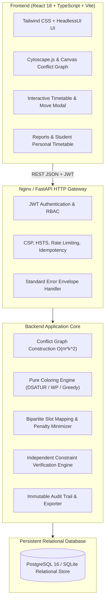

# University Examination Timetable Scheduling System

An enterprise-grade, explainable, constraint-based university examination scheduling system powered by Graph Coloring algorithms (**DSATUR**, **Welsh–Powell**, and **Greedy Coloring**).

---

## 1. System Overview & Problem Statement

### The Examination Timetabling Problem
University examination scheduling requires partitioning a large set of examinations $E = \{e_1, e_2, \dots, e_n\}$ into conflict-free calendar time slots $\{T_1, T_2, \dots, T_k\}$ such that no student is scheduled to sit two exams simultaneously.

Mathematically, this maps to the **Vertex Coloring Problem** on an undirected **Conflict Graph** $G = (V, E_G)$:
- **Vertices ($V$):** Each examination $e_i \in E$.
- **Edges ($E_G$):** An edge exists between exams $u$ and $v$ if and only if at least one student is enrolled in both: $|Enroll(u) \cap Enroll(v)| \ge 1$.
- **Edge Weights ($w$):** The number of shared students.
- **Coloring ($c: V \to \{0, 1, \dots, k-1\}$):** A proper vertex coloring guarantees $\forall (u, v) \in E_G \implies c(u) \ne c(v)$.

Each color represents an independent conflict-free session group, which is subsequently mapped to physical calendar time slots while optimizing soft constraints (minimizing back-to-back exams, same-day multiple exams, and session imbalances).

---

## 2. System Architecture



---

## 3. Core Tech Stack

- **Backend:** Python 3.11+, FastAPI, SQLAlchemy 2.0 (Mapped Columns), Alembic, Pydantic v2, ReportLab, OpenPyXL
- **Algorithms:** DSATUR (Brélaz, 1979), Welsh–Powell (1967), Greedy Coloring, Bipartite Slot Mapping
- **Frontend:** React 18, Vite, TypeScript (strict), Tailwind CSS, Lucide Icons, Canvas / Cytoscape
- **Database:** PostgreSQL 16 (production) / SQLite (zero-dependency development)
- **Quality Assurance:** Pytest, Vitest, Hypothesis (property-based testing), Playwright E2E

---

## 4. Quickstart Guide

### Option A: Running Locally with Pre-configured Demo Data (Fastest)

#### 1. Backend Setup
```bash
# Clone the repository
git clone https://github.com/sakararya43-web/Uni_Timetable.git
cd Uni_Timetable/backend

# Create virtual environment and install dependencies
python -m venv .venv
source .venv/bin/activate  # On Windows: .venv\Scripts\activate
pip install -e ".[dev]"

# Run database migrations
python -m alembic upgrade head

# Seed demonstration dataset (Departments, Subjects, 50 Students, Cycle, Graph)
python -m app.scripts.seed_demo

# Start backend server
uvicorn app.main:app --host 0.0.0.0 --port 8000 --reload
```
- API & Interactive OpenAPI Docs: [http://localhost:8000/docs](http://localhost:8000/docs)
- Health Check: [http://localhost:8000/health](http://localhost:8000/health)

#### 2. Frontend Setup
```bash
# In a new terminal:
cd Uni_Timetable/frontend
npm install
npm run dev
```
- Web Application: [http://localhost:5173](http://localhost:5173)

---

## 5. Demo Accounts & Seed Dataset

The seed script (`python -m app.scripts.seed_demo`) generates a complete demo university environment:

| Role | Email | Password | Scope & Permissions |
|---|---|---|---|
| **Administrator** | `admin@univ.edu` | `AdminPass123!` | Full system access, publishing, user management, audit logs |
| **Coordinator** | `coordinator@univ.edu` | `CoordPass123!` | Department scheduling, manual moves, exam locking, regeneration |
| **Faculty** | `faculty@univ.edu` | `FacultyPass123!` | Read-only inspection of master schedule and department timetable |
| **Student** | `student@univ.edu` | `StudentPass123!` | Personal timetable view (`/me/timetable`) with FERPA isolation |

*Alternatively, Administrators can load demo data at any time directly in the UI under **Settings -> Demo & Help -> Load Demo Data**.*

---

## 6. Running Automated Tests

```bash
# Run all backend unit, integration, and Hypothesis property-based tests (129 tests)
pytest backend/tests -v

# Run backend linting and strict type checking (82 source files)
python -m ruff check backend/app backend/tests
python -m mypy backend/app

# Run frontend unit & component tests (21 tests)
npm --prefix frontend run test:run

# Verify frontend production build
npm --prefix frontend run build
```

---

## 7. Comprehensive Architecture Documentation

- [Formal Conflict Graph Mathematical Model](docs/graph-model.md): Mathematical formulations, vertex degree metrics, and $O(m)$ construction proofs.
- [Coloring Algorithms & Complexity Analysis](docs/algorithms.md): Pseudocode, correctness invariant proofs, heap vs linear scan trade-offs, and empirical benchmarks.
- [Scheduling & Constraint Optimization Engine](docs/scheduling.md): Hard vs soft constraints, penalty weight formulations, and locked-exam precoloring.
- [API Reference Guide](docs/api.md): REST endpoints, error envelopes, curl examples, and exported Postman collection.
- [Operations & Runbook](docs/operations.md): Production deployment, Alembic migration release step, WAL archiving, backup/restore, and alerting thresholds.

---

## 8. Known Limitations & Roadmap

### Known Limitations (MVP Scope)
1. **Heuristic Approximations:** Graph vertex coloring is NP-hard. DSATUR and Welsh-Powell provide polynomial-time heuristics that guarantee valid, proper colorings within $1-2$ colors of the chromatic number $\chi(G)$, but are not guaranteed to find the absolute theoretical minimum for arbitrary dense graphs.
2. **Fixed Duration Sessions:** The current version assumes exams map into configured calendar session windows (e.g. 180 min Morning/Afternoon blocks).
3. **Single Campus & Room Modeling:** Classroom and invigilator allocation are intentionally modeled as secondary post-coloring resource assignments.
4. **Synchronous Generation:** Algorithmic generation runs synchronously in-process. Benchmarks confirm $\le 500$ exams complete in under $100\text{ ms}$, but enterprise scales ($\ge 10,000$ exams) should utilize the Redis task queue outlined in `docs/task-queue-architecture.md`.

### Post-MVP Enhancements (P2 Backlog)
- Room entity capacity allocation and invigilator assignment.
- Exact branch-and-bound solver for small subgraphs.
- Automated iCalendar (.ics) calendar sync and email notifications.
- Genetic algorithm local search for fine-grained soft penalty minimization.
