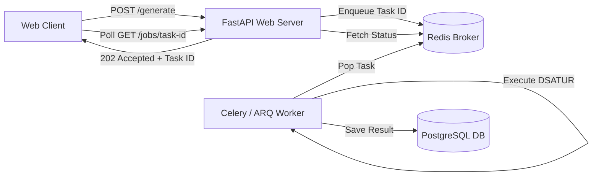
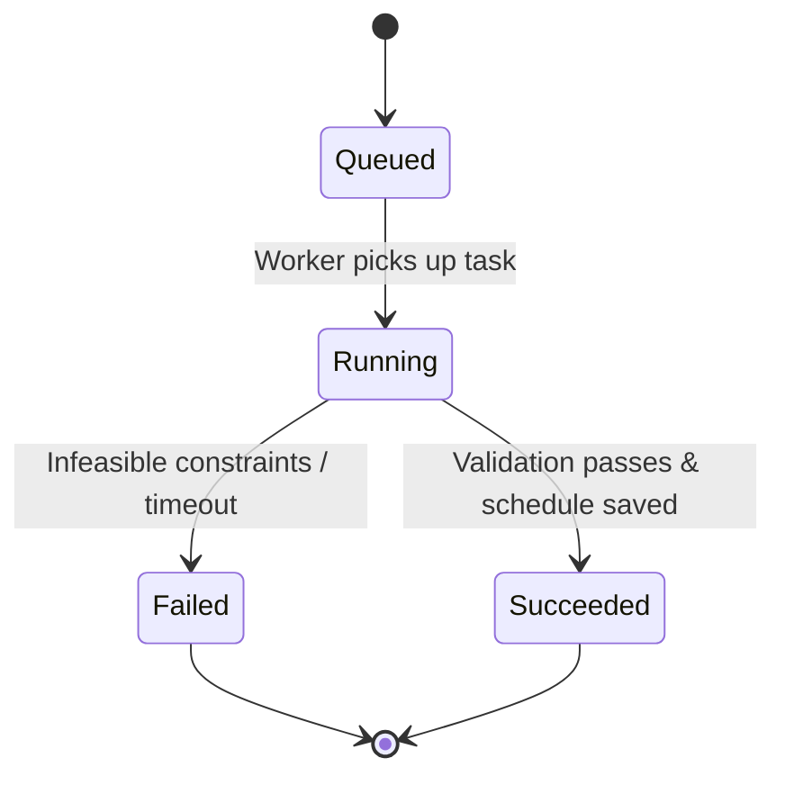

# Asynchronous Background Worker Task Queue Evolution

**Document Reference:** PRD §19, §27, Task P14.23  
**Architecture Status:** Technical Architecture Blueprint  
**Target Workload:** Large-scale institutional imports (50,000+ CSV rows) & batch regeneration  

---

## 1. Architectural Motivation

Currently, schedule generation for 500 exams executes in under 200 ms synchronously within the FastAPI request cycle. However, for future workloads exceeding 2,000 exams, multi-file ZIP imports, or distributed genetic local search, moving long-running tasks off the HTTP thread pool ensures resilience and zero request timeouts.

---

## 2. Component Blueprint

### 2.1 Message Broker
- **Redis 7.2+**: Lightweight in-memory broker with sub-millisecond job dispatch latency.
- Alternative: **RabbitMQ** for durable AMQP queue routing if persistent store-and-forward is mandated by university IT.

### 2.2 Worker Framework Choice
- **Celery 5.4+**: Robust ecosystem with retry policies, rate limiting, and workflow chaining (`chord`, `group`).
- **ARQ / SAQ**: Lightweight async Python worker using `asyncio` and `redis-py` directly matching FastAPI's native async architecture.

### 2.3 Job Status Lifecycle

### 2.4 Endpoints Evolution

| Route | Method | Description |
| :--- | :--- | :--- |
| `/api/v1/jobs/{job_id}` | `GET` | Returns execution status (`queued`, `running`, `succeeded`, `failed`), progress percentage, and result payload. |
| `/api/v1/jobs/{job_id}/cancel` | `POST` | Gracefully cancels an in-flight background generation task. |
